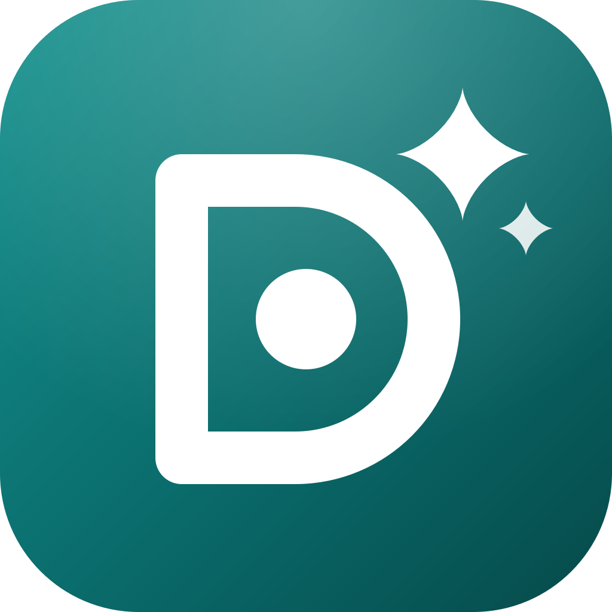

<p align="center">
  
</p>

<h1 align="center">Dimi Intelligent Recorder</h1>

<p align="center">
  Record your screen, webcam and microphone straight onto a multi-track timeline,<br />
  then edit, transcribe, caption and export, all on your own computer.
</p>

<p align="center">
  <a href="https://github.com/techussain/dimi-intelligent-recorder/actions/workflows/ci.yml"></a>
  <a href="LICENSE"></a>
  <a href="https://github.com/techussain/dimi-intelligent-recorder/releases"></a>
</p>

---

Dimi is a video editor you record into. Clips appear on the timeline while you are still
recording, so you can trim, split and arrange as you go. Transcription, captions and silence
removal run on your machine. There is no account and nothing is uploaded.

It is a desktop app for Windows and macOS (Electron), and also runs in Chrome or Edge.

## Features

- **Recording:** screen or window, system audio (Windows), microphone and webcam, each on its
  own track. Pause and resume, countdown, region crop, device selection and a floating webcam
  self-view. Every recording is also saved as a normal file in your recordings folder.
- **Editing:** multi-track timeline with split, trim, ripple delete, razor, multi-select,
  snapping, markers, linked clips, track lock / mute / solo, and undo / redo. Text, shapes,
  animated elements, transitions, keyframes, colour adjustments, effects (zoom, fade, spotlight,
  shake, chroma key) and blend modes. Merge a selection into one clip.
- **Layout:** align and distribute, smart guides, rulers, transform and crop tools, layer order,
  copy / paste and paste attributes.
- **On-device AI:** English transcription with Whisper, captions exportable as `.srt`, and
  silence removal that cuts pauses from every track at once.
- **Export and projects:** MP4 (H.264 / AAC) or WebM (VP9 / Opus). Autosave, recent projects,
  `.irproj` project files and portable `.irbundle` archives.

## Download

Installers for Windows 10/11 (64-bit) and macOS 13 or later are on the
[Releases](https://github.com/techussain/dimi-intelligent-recorder/releases) page.

Builds without a code-signing certificate show a warning the first time you open them. On
Windows choose **More info → Run anyway**. On macOS right-click the app and choose **Open**.
Signed builds update themselves; unsigned builds show a notice when a new version is out.

On macOS, recording needs **Screen Recording**, **Camera** and **Microphone** access in System
Settings → Privacy & Security.

## Build from source

You need **Node.js 22.12+** and npm.

```sh
git clone https://github.com/techussain/dimi-intelligent-recorder.git
cd dimi-intelligent-recorder
npm ci
npm run dev:electron   # desktop app with hot reload
npm run dev            # browser version at http://localhost:5173 (Chrome / Edge 120+)
```

The first `npm run dev:electron` downloads Electron (about 100 MB), so it takes a little longer.
If you start it from a VS Code terminal and a built app closes immediately, unset
`ELECTRON_RUN_AS_NODE`.

| Command                           | What it does                                                     |
| --------------------------------- | ---------------------------------------------------------------- |
| `npm run build:electron`          | Builds installers for your system into `release/`                |
| `npm run build`                   | Type-checks and builds the web app into `dist/`                  |
| `npm run electron:precompile`     | Compiles `electron/*.cts` into `dist-electron/`                  |
| `npm test`                        | Unit tests (Vitest)                                              |
| `npm run lint`                    | ESLint                                                           |
| `npm run format` / `format:check` | Prettier                                                         |
| `npm run notices`                 | Regenerates `build/THIRD_PARTY_NOTICES.txt` (ships with the app) |

## How it works

```
src/
  components/       React UI: editor, timeline, preview, inspector, media library, dialogs
  lib/timeline/     Editor state (Zustand + Immer), undo / redo, selectors
  lib/capture/      One MediaRecorder per source; clips grow live, files are finalized on stop
  lib/compositor/   Scene model shared by the preview and the export
  lib/export/       Offline render to MP4 / WebM with mediabunny (WebCodecs)
  lib/transcribe/   Whisper transcription, captions, .srt
  lib/persistence/  Autosave, .irproj / .irbundle, schema validation
  lib/storage/      Private storage (OPFS), recordings folder, media clean-up
  workers/          Background work: file writing, waveforms, transcription, silence analysis
electron/
  main.cts          Windows, menus, tray, security headers, capture sources, webcam overlay
  mediaStore.cts    Recordings folder access rules
  updater.cts       Update checks against GitHub Releases
```

- **Storage.** The editor works from the app's private storage and keeps projects in IndexedDB.
  In the desktop app, recordings and imported files also exist as real files on disk, so a
  project can restore its media if the private storage is cleared. Recordings go to
  `Videos/Dimi Intelligent Recorder` (`Movies/…` on macOS); change it with
  **File ▸ Change Recordings Folder…**.
- **Transcription.** The Whisper model (`onnx-community/whisper-base.en`, about 77 MB) downloads
  once from Hugging Face after you agree. It is pinned to a fixed version and checked against
  known checksums, then works offline. Audio never leaves your computer.
- **Security.** The renderer is sandboxed with context isolation and a strict Content Security
  Policy, and the app is served from its own `app://` origin. The main process validates every
  IPC message, writes only inside the recordings folder, and reads only files you recorded or
  chose.

## Privacy

Everything is processed on your computer. No account, analytics or telemetry. The app goes
online only for the one-time speech-model download and for update checks. Details are in
[PRIVACY.md](PRIVACY.md).

## Contributing

Bug reports, fixes and features are welcome.

- **Issues:** search the [existing issues](https://github.com/techussain/dimi-intelligent-recorder/issues)
  first. For bugs, include your OS, the app version (**Help → About**), the steps, and the logs
  from **Help → Open Logs Folder**.
- **Pull requests:** keep each one focused, add tests for logic changes, and run the same checks
  as CI before you open it:

  ```sh
  npm run format:check && npm run lint && npm run build && npm run electron:precompile && npm test
  ```

- **Code:** each user-visible edit is one store action (one undo step); heavy work belongs in a
  worker; new IPC must validate its sender and arguments; new network access needs a strong
  reason and an update to [PRIVACY.md](PRIVACY.md). Renderer packages go in `devDependencies`;
  run `npm run notices` after adding one.
- **Testing on a real machine:** for changes to recording, playback or export, try a take with
  screen, webcam, mic and system audio; pause and resume; stop and check that all clips line up;
  play it back; export MP4 and WebM; save and reopen the project.

By contributing, you agree that your contributions are licensed under the [MIT License](LICENSE).

## Security

Please don't report security problems in public issues. Use
[Report a vulnerability](https://github.com/techussain/dimi-intelligent-recorder/security/advisories/new)
on GitHub with the version, OS, impact and steps to reproduce. Fixes are released for the latest
version only.

## Releasing

1. Bump the version: `npm version 1.2.3 --no-git-tag-version`.
2. Add a `## [1.2.3]` section to [CHANGELOG.md](CHANGELOG.md). It becomes the release notes.
3. Commit, then push a tag: `git tag v1.2.3 && git push origin v1.2.3`.

The [release workflow](.github/workflows/release.yml) builds the Windows and macOS installers and
publishes them to Releases. Builds are code-signed when these repository secrets are set, and
unsigned otherwise:

| Secret                                                     | Used for                                   |
| ---------------------------------------------------------- | ------------------------------------------ |
| `WIN_CSC_LINK`, `WIN_CSC_KEY_PASSWORD`                     | Windows code-signing certificate (`.pfx`)  |
| `MAC_CSC_LINK`, `MAC_CSC_KEY_PASSWORD`                     | macOS Developer ID Application certificate |
| `APPLE_ID`, `APPLE_APP_SPECIFIC_PASSWORD`, `APPLE_TEAM_ID` | macOS notarization                         |

## Known limitations

- No official Linux release yet (`npm run build:electron` makes an untested AppImage).
- System-audio capture works on Windows only.
- Transcription is English only and runs on the CPU.
- Speed-changed clips are pitch-shifted in exports.
- The preview plays the top clip of each track, so audio crossfades are heard in exports only.

## Acknowledgements

Built with [Electron](https://www.electronjs.org/), [React](https://react.dev/),
[Vite](https://vite.dev/), [Zustand](https://github.com/pmndrs/zustand),
[mediabunny](https://github.com/Vanilagy/mediabunny),
[Transformers.js](https://github.com/huggingface/transformers.js),
[ONNX Runtime](https://onnxruntime.ai/) and OpenAI's
[Whisper](https://github.com/openai/whisper) model. Third-party licenses are in
`build/THIRD_PARTY_NOTICES.txt`.

## License

[MIT](LICENSE) © 2026 techussain
